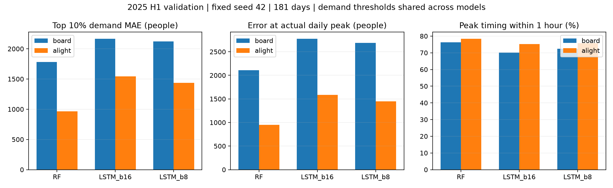

# ANALYSIS-001 피크·고수요 오차 분석

- 2026-11-11 사용자 승인: 피크·고수요 분석 후 다음 실험 추천, 결과 기록·커밋. 새 학습·결합 모델·하반기 최종 평가 미실행.
- 동일 2025년 상반기 181일, 06~24시 18시간, 승하차 6,516개 관측값. 시드42 고정 RF3일(나무200·깊이10·잎3), LSTM14일 1층·배치16, EXP-011 1층·배치8 비교. 모두 기존 음수0 보정 예측. 세 시드 평균이나 앙상블 결과가 아니다.
- 고수요: 검증 실제값의 승차/하차별 90% 분위수 이상. 기본 상위10%, 민감도 상위5%·20%. 선형 분위수, 경계 동률 포함. 모델에 동일 집단 적용. 사후 진단이며 운영 혼잡 기준·입력 정보·새 모델 선택 지표가 아니다.
- 상위10% 기준 승차1049.3명(정수 실제값1050명 이상), 하차1425.6명(1426명 이상), 각각326개. 나머지 각각2932개.
- 피크: 각 날짜·승하차별 최대값, 동률이면 가장 이른 시간. 시각 오차는 예측 최대시각−실제 최대시각. 실제 피크 시점 오차와 두 곡선 최대 크기 차이를 별도 기록한다. 총량은 18시간 합계, 고유 이용객 수가 아니다. 지표 합이 MAE가 되는 분해는 아니다.
- 다중 피크 보조표시: 실제 최대의95% 이상인 시간이 떨어진 두 구간 이상이면 표시(승차4일/하차7일). 약한 피크는 최대≤일평균1.5배라는 탐색적 규칙(승차0일/하차4일). 실제 최대 동률 승차0일/하차1일. 모든 날짜를 기본 집계에 유지하고 날짜별 파일에 표시한다.

## 결과

단위는 인원 오차 명. 일반 구간은 상위10% 외 나머지이다.

| 모델 | 전체 MAE | 고수요 승차 MAE | 일반 승차 MAE | 고수요 하차 MAE | 일반 하차 MAE |
|---|---:|---:|---:|---:|---:|
| RF | 255.87 | 1780.26 | 145.89 | 962.88 | 117.75 |
| LSTM 배치16 | 275.65 | 2167.57 | 93.76 | 1543.24 | 106.25 |
| LSTM 배치8 | 269.26 | 2120.38 | 96.65 | 1435.24 | 106.42 |

배치8은 배치16 대비 고수요 승차47.20명·하차108.00명 개선되지만 일반 구간은 각각2.89명·0.17명 악화한다. RF는 고수요에서, LSTM은 일반 구간에서 낮은 MAE를 보인다. 이는 집단별 관찰이며 실제값을 미리 보고 모델을 골라 쓰는 전략이 아니다.

| 모델 | 고수요 승차 과소예측 비율 | 승차 평균 부족 인원 | 승차 고수요 누락률 | 하차 평균 부족 인원 | 하차 고수요 누락률 |
|---|---:|---:|---:|---:|---:|
| RF | 83.7% | 1496.82 | 46.6% | 865.18 | 32.8% |
| LSTM 배치16 | 81.6% | 2020.80 | 51.2% | 1478.14 | 36.2% |
| LSTM 배치8 | 77.9% | 1941.30 | 49.1% | 1365.99 | 32.8% |

평균 부족 인원은 고수요 집단 전체에서 max(실제−예측,0)을 평균한다. 누락률 분모는 실제 고수요326개, 분자는 예측이 동일 기준 미만인 수이다. 과소예측 빈도만 낮아도 부족 규모는 클 수 있다. 오탐 수와 일반 집단을 분모로 한 오탐률도 JSON에 기록했다(승차 RF115건/3.9%, 배치8 87건/3.0%).

승차 상위10%가 전체 승차 절대오차에서 차지하는 비중은 RF57.6%, 배치16 72.0%, 배치8 70.9%이다. 하차는47.6%/61.8%/60.0%. 상위5%·20%에서도 양방향 고수요 MAE 순서는 RF < 배치8 < 배치16으로 유지된다. 기준별 표본 수와 전체 수의 합, 가중 집계가 전체 MAE와 일치함을 검증했다.

## 피크·총량

| 모델 | 승차 실제 피크 시점 MAE | 하차 실제 피크 시점 MAE | 승차 시각 ±1시간 | 하차 시각 ±1시간 | 승차 일총량 MAE | 하차 일총량 MAE |
|---|---:|---:|---:|---:|---:|---:|
| RF | 2111.21 | 949.46 | 76.2% | 78.5% | 2202.01 | 2450.91 |
| LSTM 배치16 | 2777.24 | 1588.27 | 70.2% | 75.1% | 3536.94 | 3256.76 |
| LSTM 배치8 | 2690.56 | 1449.56 | 72.4% | 75.7% | 3257.93 | 3012.61 |

배치8 승차 피크의 평균 부호오차는 −2573.67명, 하차 −1364.90명이다. 시각이 ±1시간 이내인 날만 보아도 실제 피크 시점 MAE는 승차2627.47명(131일), 하차1495.31명(137일)이다. 시각 문제와 규모 문제가 함께 남는다. 이 조건부 집단은 모델별 날짜가 달라 모델 간 공정한 우열 비교로 쓰지 않는다.

## 다음 실험 추천 — 아직 미실행

1. **LSTM 1층·배치8에서 손실 함수 비교 우선.** 구조·입력·날짜·시드는 유지하고 MAE 기준과 Huber 또는 MSE를 별도 조건으로 비교한다. 큰 피크의 과소예측이 남아 큰 오차 반영 방식을 확인할 근거가 있다. 손실 함수가 원인이라고 입증한 것은 아니다. MSE는 큰 오차 반영이 강하지만 극단값·평소 성능 악화 위험이 있고, Huber는 절충이지만 delta 선정이 필요하다. 원래 인원 단위에서 delta=1을 무심코 쓰면 대부분 큰 오차 구간이 선형이므로 기대한 차이가 작을 수 있다. delta와 학습률·손실 스케일 영향은 실행 전 합의한다. 조기 종료·선택은 기존 검증 MAE를 유지하고, 학습 로그의 loss를 MAE로 잘못 표기하지 않도록 구현을 점검한다.
2. **RF·LSTM 보완성 및 50:50 결합은 그 다음 저비용 후보.** RF 고수요/LSTM 일반 구간의 차이는 근거지만 평균 결합 개선을 보장하지 않는다. 새 손실 실험과 한꺼번에 섞지 않는다. 아직 결합 점수를 계산하거나 가중치를 변경하지 않았다.
3. 추가 층 확대는 우선순위를 낮춘다. EXP-012에서 3층·배치8이 기존1층·배치8보다 동일3시드 모두 나빴다. 입력 누락·피크 시각 불확실성은 손실 변경만으로 해결된다고 보장할 수 없다.

처음에는 같은 시드42로 후보를 비교하고 유망한 조건을 기존 동일3시드로 확인하는 방안을 추천한다. 현재 분석은 단일 시드의 검증 사후 분석이며 일반화·통계적 유의성·행사 인과효과를 주장하지 않는다. 새로운 지표는 진단용이며 전체 MAE 선택 원칙을 변경하지 않았다.

## 재현·검증

- 실행: 저장소 루트에서 `python tools/analyze_peak_demand.py` (NumPy 및 Matplotlib 필요; 실행 환경 Windows Python3.12, NumPy2.5.4, Matplotlib3.11.2).
- 원본 파일 SHA256, 전체·월별·고수요 기준별 지표: [요약 JSON](../metrics/peak_demand_analysis.json).
- 181일×승하차2×모델3=1086개 날짜별 진단: [날짜별 JSON](../metrics/peak_demand_daily.json).
- 날짜·시간·승하차 키6516개 유일성, 최신 모델 날짜·정답 완전 일치, 유한·음수 보정 예측, RF 기존MAE 및 최신 LSTM 보고MAE 일치 확인. 그래프 렌더 확인. 학습 데이터·소스·설정 변경 없음.
