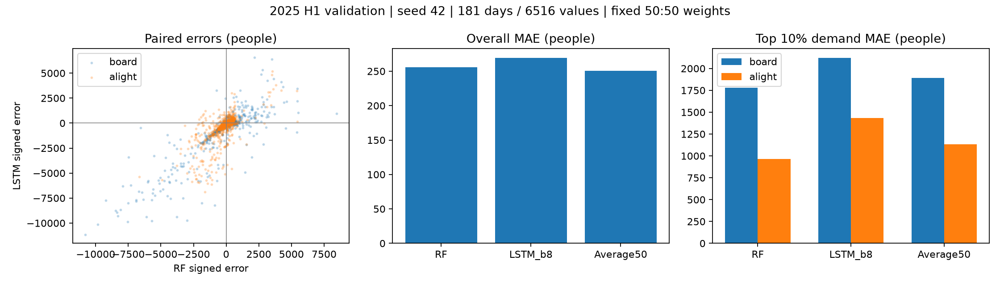

# ANALYSIS-002 RF·LSTM 보완성 및 50:50 예측 평균

- 사용자 승인(2026-11-11): 오차 보완성 분석과50:50 평균 비교·결과 기록·커밋. 새 학습 없음.
- RF3일(나무200·깊이10·잎3) 및 LSTM14일(1층32유닛·배치8·MAE·Adam0.003), 시드42. LSTM은 EXP-013 MAE 재현 실행. 기존 EXP-011 예측과 복원 일치 확인된 모델이다.
- 동일2025상반기181일×18시간×승하차2=6516개. 음수0 보정한 두 예측을 각각0.5배하여 합산. 반올림·가중치 탐색·실제값에 따른 모델 선택 없음. 하반기 최종 평가 미사용.
- 고수요는 승차·하차 각각 검증 실제값 상위10%(326개), 민감도5/20%, 경계동률 포함. 사후 진단이며 운영 혼잡 기준이 아니다. 피크 동률은 가장 이른 시간.

| 모델 | 전체 MAE | 승차 MAE | 하차 MAE | 평균 부호오차 |
|---|---:|---:|---:|---:|
| RF | 255.87 | 309.43 | 202.31 | -35.00 |
| LSTM_b8 | 269.26 | 299.15 | 239.38 | -135.26 |
| Average50 | 250.55 | 292.56 | 208.53 | -85.13 |

## 고수요·일반·피크

| 모델 | 구분 | 고수요 MAE | 일반 MAE | 고수요 부족 인원 | 고수요 누락률 | 실제 피크 MAE |
|---|---|---:|---:|---:|---:|---:|
| RF | board | 1780.26 | 145.89 | 1496.82 | 46.6% | 2111.21 |
| RF | alight | 962.88 | 117.75 | 865.18 | 32.8% | 949.46 |
| LSTM_b8 | board | 2120.38 | 96.65 | 1941.30 | 49.1% | 2690.56 |
| LSTM_b8 | alight | 1435.24 | 106.42 | 1365.99 | 32.8% | 1449.56 |
| Average50 | board | 1894.06 | 114.50 | 1690.93 | 41.1% | 2387.47 |
| Average50 | alight | 1135.32 | 105.49 | 1083.71 | 29.8% | 1162.05 |

## 월별 MAE

| 월 | RF | LSTM | 평균 |
|---|---:|---:|---:|
| 1 | 111.80 | 84.44 | 94.59 |
| 2 | 105.70 | 75.40 | 86.28 |
| 3 | 263.78 | 276.15 | 258.95 |
| 4 | 355.81 | 387.00 | 359.15 |
| 5 | 378.89 | 418.78 | 381.01 |
| 6 | 309.67 | 361.83 | 312.92 |

## 보완성

- 관측값별 RF 우세 44.6%, LSTM 우세 55.4%, 동률 0.0%. 우세 횟수는 오차 크기와 달라 평균 성능의 순위를 대신하지 않는다.
- 부호오차 상관 0.792, 절대오차 상관 0.807. 함께 과소 33.1%, 함께 과대 41.8%, 반대 방향 25.1%, 적어도 한쪽 정확히0 0.0%.
- 각 모델 절대오차 상위10% 집단: RF 652개, LSTM 652개, 교집합 487개, Jaccard 0.596. 이는 실제 수요 상위10%와 다른 집단이다.
- 두 단일 MAE의 평균 대비 오차 상쇄 이득 12.02명. 평균 예측 MAE는 각 MAE의 산술평균과 다르며, 더 좋은 단일 모델보다 낮다고 보장되지 않는다.

- RF 대비 평균 예측 MAE 감소 +5.32명 (+2.08%). 양수 개선·음수 악화.
- LSTM_b8 대비 평균 예측 MAE 감소 +18.72명 (+6.95%). 양수 개선·음수 악화.

## 해석과 다음 단계

- 전체 MAE는 두 단일 모델보다 낮지만, RF 대비 하차 전체·고수요 승하차·실제 피크 시점 오차는 악화했다. 일반 하차 구간은 두 모델보다 개선했다. 평균 성능 개선과 피크 대응 개선을 구분한다.
- 평균의 월별 MAE는 RF 대비1~3월 개선,4~6월 악화. LSTM 대비1~2월 악화,3~6월 개선이다. 모든 월에서 더 좋은 모델이 된 것은 아니다.
- 약25%의 반대 방향 오차가 일부 상쇄되지만 오차 상관은 높고, 큰 오차652개 중487개가 겹친다. 두 모델 모두 놓치는 급증을 평균만으로 해결했다고 해석하지 않는다.
- 다음 추천: 50:50을 그대로 고정하고 동일3시드42·907394·892611에서 각 RF/LSTM 예측쌍을 비교하여 개선 방향과 평균·표준편차를 확인한다. 각 시드별 두 모델 예측을 먼저 평균한 뒤 점수를 산출한다. 시드 점수 평균을 예측 평균으로 대신하지 않는다. 가중치 탐색·새 학습·3시드 확장은 이번에 실행하지 않았다.

## 검증·한계

- 날짜·키 유일성, 정답 배열 완전 일치, 원본 SHA256, 기존 두 모델MAE 재현, 평균이 두 예측 사이에 위치함, 구간 가중 평균MAE 재현, 절대오차 삼각부등식 확인.
- 단일 시드의 반복 사용된 검증기간 분석. 3/5시드 평균이나 독립 최종 평가가 아니다. 조건별 개선은 다음 시드 검증의 후보일 뿐이다. 새 학습 및 결합 비율 튜닝 미실행.
- 재현: python tools/analyze_ensemble.py (NumPy·Matplotlib). 상세 시간대·월별·승하차·고수요5/10/20%·피크 결과와 입력 SHA256은 [JSON](../metrics/ensemble_analysis.json). 개별 평균 예측은 outputs/ensemble-analysis-2026-11-11/validation_predictions.npz.

