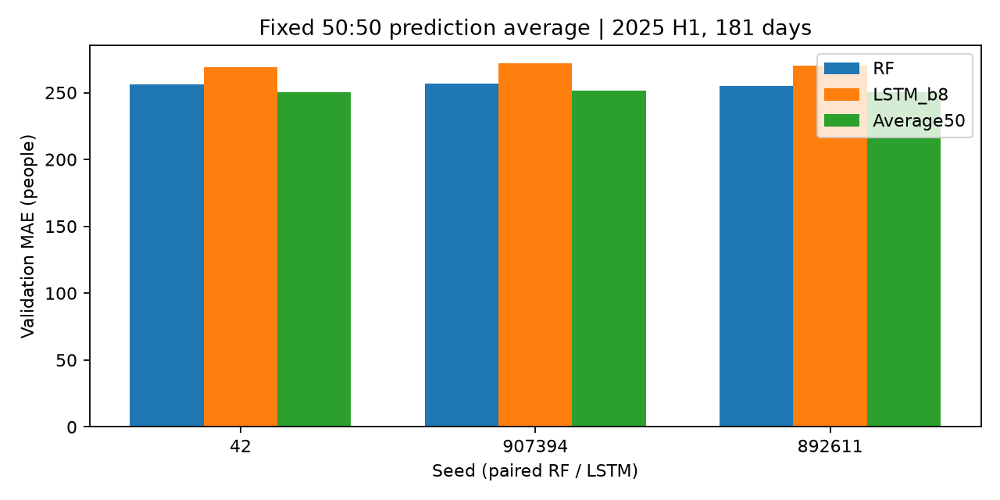

# ANALYSIS-003 RF·LSTM 50:50 동일3시드 비교

- 2026-11-11 사용자 승인: 50:50 유지, 시드42·907394·892611 비교·기존 결과 대조·기록·커밋.
- RF3일·나무200·깊이10·잎3, LSTM14일·32유닛1층·배치8·MAE·Adam0.003. 저장된 여섯 모델 예측 재사용. 재학습·가중치 탐색·최종 평가 미실행.
- 같은 시드 안에서 음수0 보정된 두 예측을 0.5씩 평균하고 점수를 계산한다. 시드별 점수의 평균±표본SD를 보고하며 여섯 모델을 한꺼번에 합친 앙상블 점수가 아니다.
- 동일2025상반기181일×18시간×승하차2=6516개. 세 시드에서 같은 날짜를 사용하므로 독립 표본19548개라고 주장하지 않는다. 최종2025하반기는 미평가.

| 시드 | RF MAE | LSTM MAE | 평균 MAE | RF 대비 감소 | LSTM 대비 감소 |
|---|---:|---:|---:|---:|---:|
| 42 | 255.87 | 269.26 | 250.55 | +5.32 | +18.72 |
| 907394 | 256.55 | 271.69 | 251.17 | +5.38 | +20.51 |
| 892611 | 254.78 | 270.42 | 250.08 | +4.69 | +20.34 |

| 모델 | 동일3시드 평균 MAE | 표본 SD |
|---|---:|---:|
| RF | 255.73 | 0.89 |
| LSTM_b8 | 270.46 | 1.21 |
| Average50 | 250.60 | 0.55 |

- RF 대비 평균 5.13명(2.01%) 개선, 개선 시드 3/3.

- LSTM_b8 대비 평균 19.86명(7.34%) 개선, 개선 시드 3/3.

## 방향·고수요·피크 (시드별 지표의 평균)

고수요: 실제값 상위10%, 승차1050명 이상/하차1426명 이상 각각326개. 사후 진단용. 상위5%·20% 민감도·누락률은 JSON 보존. 피크 동률이면 가장 이른 시각.

| 모델 | 방향 | 전체 MAE | 고수요 MAE | 일반 MAE | 고수요 부족 인원 | 실제 피크 MAE |
|---|---|---:|---:|---:|---:|---:|
| RF | board | 309.57 | 1774.86 | 146.65 | 1490.08 | 2100.61 |
| RF | alight | 201.89 | 952.46 | 118.44 | 853.68 | 941.06 |
| LSTM_b8 | board | 299.25 | 2133.74 | 95.28 | 1959.34 | 2706.35 |
| LSTM_b8 | alight | 241.67 | 1454.21 | 106.85 | 1385.83 | 1466.77 |
| Average50 | board | 292.26 | 1895.85 | 113.96 | 1695.49 | 2389.36 |
| Average50 | alight | 208.94 | 1140.85 | 105.33 | 1088.50 | 1167.00 |

## 월별 MAE (3시드 평균)

| 월 | RF | LSTM | 평균 |
|---|---:|---:|---:|
| 1 | 111.43 | 81.60 | 92.81 |
| 2 | 104.88 | 74.17 | 84.09 |
| 3 | 262.38 | 279.63 | 259.46 |
| 4 | 355.09 | 387.36 | 358.49 |
| 5 | 379.85 | 421.02 | 383.18 |
| 6 | 311.15 | 366.85 | 315.02 |

## 해석과 다음 단계

- 세 시드 모두 전체MAE가 두 단일 모델보다 낮아 시드42에서의 개선 방향이 유지됐다. 표본SD도 작았으나 세 번의 반복만으로 통계적 유의성을 주장하지 않는다.
- RF 대비 승차 전체MAE는 개선하고 하차 전체MAE는 악화했다. 고수요 승차·하차 및 실제 피크 시점 MAE는 RF보다 악화한다. 3시드 평균에서도 월별1~3월 개선·4~6월 악화 패턴이 유지된다.
- 50:50을 최종 평가 후보로 유지할 근거가 생겼다. 다음에는 RF 단독과 고정50:50 중 최종 비교 대상 및 단일시드/시드평균 예측 등 배포 방식, 최종평가 절차를 먼저 확정하는 것을 추천한다. 이번 점수250.60은 세 시드 점수 평균이며 단일 결합 모델의 점수가 아니다. 새 기간 평가나 가중치 탐색은 추가 실행하지 않았다.

## 검증과 해석 범위

- 기존 시드42 ANALYSIS-002 결과와 세 모델 점수가 일치한다. 원본해시·정답·날짜 일치, 개별 기존MAE 재현, 평균 범위·구간 가중합을 검증했다. 여섯 저장 모델은 이전 실험에서 복원 검증을 완료한 예측을 재사용했다.
- RF 과거5시드 평균과 빼서 개선율을 계산하지 않고 같은3시드 RF를 기준으로 계산했다. 표본SD는 학습 난수의 변동이며 신뢰구간이 아니다.
- 새 기간 일반화나 통계적 유의성을 보장하지 않는다. 전체MAE 개선과 고수요·피크 및 월별 악화는 함께 판단한다. 추가 가중치 탐색은 실행하지 않았다.
- 재현: python tools/analyze_ensemble_seeds.py. [전체 JSON](../metrics/ensemble_seeds.json), outputs/ensemble-seeds-2026-11-11/seed*.npz에 시드별 평균 예측 보존.

