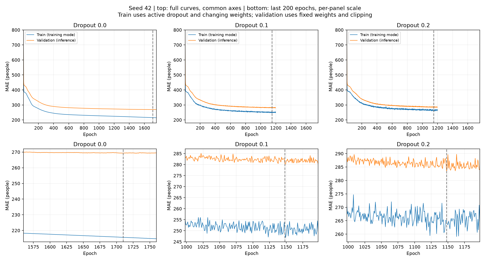

# ANALYSIS-004 Dropout 전후 학습·검증 곡선 진단

- 2026-11-11 사용자 요청: 기존 곡선의 과적합 징후와 Dropout 전후 비교. EXP-014 시드42, 비율0/0.1/0.2. 새 학습·최종 평가 없음.
- 학습 곡선은 에포크 중 가중치를 갱신하며 산출한 배치별 원래 MAE. Dropout0.1/0.2에서는 학습 시 무작위 마스킹이 적용된다. 검증은 에포크 끝 고정 가중치·Dropout OFF·음수0 보정 MAE이다. 따라서 두 곡선의 단순 차이를 동일 조건의 일반화 격차로 해석하지 않는다.
- 이를 보완하여 저장된 최선 체크포인트를 training=False로 불러와 학습352일/검증181일 모두 같은 음수0 보정 기준으로 추가 추론했다. 과거 각 에포크의 동일조건 학습오차는 저장돼 있지 않으므로 복원하지 않았다.
- 종료 전50회 선형기울기와 앞25회/뒤25회 평균 차이로 단일 에포크 잡음을 함께 점검한다. 기울기는100에포크당 명, 통계검정이 아닌 기술통계다. 최선~종료 차이는 최솟값 기준이므로 그 자체로 과적합 증거가 되지 않는다.

| Dropout | 최선/종료 | 최선시 학습로그 MAE | 최선 검증 MAE | 최선→종료 학습 변화 | 최선→종료 검증 변화 |
|---|---|---:|---:|---:|---:|
| 0.0 | 1710/1760 | 215.60 | 269.26 | -0.91 | +0.19 |
| 0.1 | 1148/1198 | 250.19 | 280.09 | -0.40 | +0.13 |
| 0.2 | 1148/1198 | 264.79 | 283.34 | -0.94 | +0.84 |

## 종료 직전50회 추세

| Dropout | 학습 기울기/100회 | 검증 기울기/100회 | 검증 뒤25회−앞25회 평균 |
|---|---:|---:|---:|
| 0.0 | -1.84 | -0.01 | +0.01 |
| 0.1 | +1.62 | +0.09 | +0.04 |
| 0.2 | +3.53 | -0.56 | -0.09 |

## 최선 체크포인트의 동일조건 추론

| Dropout | 학습 MAE | 검증 MAE | 검증−학습 |
|---|---:|---:|---:|
| 0.0 | 215.46 | 269.26 | 53.80 |
| 0.1 | 233.94 | 280.09 | 46.16 |
| 0.2 | 238.83 | 283.34 | 44.52 |

## 동일 에포크 비교

| Dropout | 1000회 학습로그 MAE | 1000회 검증 MAE | 1198회 학습로그 MAE | 1198회 검증 MAE |
|---|---:|---:|---:|---:|
| 0.0 | 227.62 | 274.98 | 224.60 | 273.04 |
| 0.1 | 252.58 | 283.79 | 249.79 | 280.22 |
| 0.2 | 268.46 | 288.62 | 263.85 | 284.18 |

## 판단

- Dropout0: 학습은 후반에도 내려가지만 검증은 거의 정체한다. 마지막50회 검증기울기−0.006명/100회, 앞뒤25회 평균차+0.014명으로 지속적 상승의 강한 증거는 없다. 학습에만 추가 이득이 남는 포화/약한 과적합 가능성은 있으나 심한 과적합으로 단정할 수 없다. 마지막100/200회 검증기울기는 각각−0.156/−0.246명으로 완만한 개선이었다.
- Dropout0.1: 마지막50회 검증은 약간 정체/악화하지만(+0.09명/100회) 학습로그도 함께 흔들린다. 마지막100/200회에서는 두 곡선 모두 감소한다. 끝점만으로 학습만 개선·검증 악화라는 지속적 패턴을 확정하지 않는다.
- Dropout0.2: 최선 대비 종료값은+0.84명이지만 마지막50회 검증기울기는−0.56명/100회로 내려간다. 무작위 진동 속 최저값을50회 갱신하지 못한 것이며 검증오차가 줄곧 상승한 것이 아니다.
- 최선 체크포인트 동일조건 격차는53.80→46.16→44.52명으로 줄었지만 학습MAE215.46→233.94→238.83, 검증MAE269.26→280.09→283.34로 둘 다 악화한다. 격차 축소만을 일반화 개선으로 해석할 수 없다. 학습 적합도를 낮춘 규제 효과/현재 예산에서의 학습 부족과 양립하며 원인 확정은 아니다.
- 동일1000/1198회에서도 Dropout0의 검증MAE가 더 낮아, 최종 비교 차이가 단순히0을 더 오래 학습시킨 결과만은 아니다. 다만 Dropout의 마지막100/200회는 개선 추세였으므로 patience50이 잡음 속 개선을 일찍 끊었을 가능성을 배제할 수 없다. 더 오래 학습하면 기준을 넘는다고 예측할 근거는 없다.
- 현재는 Dropout0·최선가중치 복원을 유지할 근거가 있다. 과적합이 전혀 없다는 주장이나 새로운 patience/최대회수 변경은 하지 않는다. 반복 검증자료 사용에 대한 최종 일반화 확인은 고정된 설정의 별도 하반기 평가에서 해야 한다.

## 한계

- 학습2024년과 검증2025년의 수요·행사 구성이 달라 검증−학습 격차를 과적합 하나의 원인으로 설명할 수 없다. 단일 시드·같은 검증자료 반복 선택이라는 한계가 있다.
- 세 조건 모두 검증이 최선값을50회 갱신하지 않아 종료했다. 이는 정체도 포함하며50회 연속 상승했다는 뜻이 아니다. 실제 저장 모델은 종료가중치가 아니라 최선가중치다.
- 공통전체축/후반확대축을 구분했다. 후반 그림의 패널마다 다른 세로축이 작은 변동을 크게 보이게 할 수 있으므로 수치표를 함께 읽는다.
- 재현: WSL에서 tools/analyze_dropout_curves.py inference --source <기존CSV>, Windows에서 tools/analyze_dropout_curves.py report. 기존 학습/검증만 추론하며 fit 호출 없음.
- [곡선통계 JSON](../metrics/dropout_curve_analysis.json), [최선체크포인트 재평가](../metrics/dropout_checkpoint_diagnostics.json).

