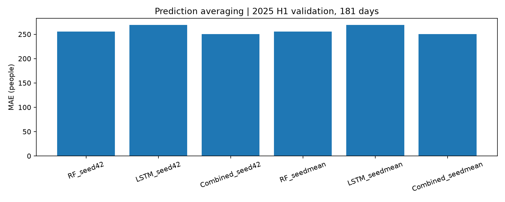

# ANALYSIS-005 세 시드 예측 평균 및 RF·LSTM 결합

- 2026-11-11 사용자 승인: RF3시드 예측 평균 및 RF·LSTM50:50 평균을 기존 결과와 비교·기록·커밋. 최종 평가는 결과 보고 결정. 새 학습·최종평가 미실행.
- 시드42·907394·892611. RF3일·나무200·깊이10·잎3, LSTM14일·1층32유닛·배치8·MAE·Adam0.003·Dropout0. 기존 여섯 모델 예측 재사용.
- 각 모델의 음수0 보정 예측을 동일 날짜·시간·승하차에서 평균. RF평균=(RF42+RF907394+RF892611)/3, LSTM평균도 동일. 결합=0.5×RF평균+0.5×LSTM평균으로 각 모델 가중치1/6. 시드별50:50 예측을 평균한 값과 수치적으로 같음. 가중치 탐색·반올림 없음.
- 동일2025상반기181일·6516개 값. 현재 계산은 예측을 합친 하나의 구성에 대한 점수이며 과거 세 시드 점수의 평균±SD와 구분. 이번 구성의 반복SD를 산출하지 않음.

| 구성 | 전체 MAE | 승차 MAE | 하차 MAE | 모델 수 |
|---|---:|---:|---:|---:|
| RF_seed42 | 255.87 | 309.43 | 202.31 | 1 |
| LSTM_seed42 | 269.26 | 299.15 | 239.38 | 1 |
| Combined_seed42 | 250.55 | 292.56 | 208.53 | 2 |
| RF_seedmean | 255.47 | 309.36 | 201.59 | 3 |
| LSTM_seedmean | 269.00 | 297.89 | 240.10 | 3 |
| Combined_seedmean | 250.16 | 291.84 | 208.48 | 6 |

## 과거 점수 평균과의 구분

| 모델 | 기존3시드 점수 평균 | 이번3시드 예측 평균의 점수 |
|---|---:|---:|
| RF_seedmean | 255.73 | 255.47 |
| LSTM_seedmean | 270.46 | 269.00 |
| Combined_seedmean | 250.60 | 250.16 |

## 고수요·피크

실제 인원 상위10%, 승차/하차 각각326개, 사후 진단. 상위5/20% 민감도는 JSON. 피크 동률은 가장 이른 시간.

| 구성 | 방향 | 고수요 MAE | 일반 MAE | 고수요 부족인원 | 피크시점 MAE |
|---|---|---:|---:|---:|---:|
| RF_seed42 | board | 1780.26 | 145.89 | 1496.82 | 2111.21 |
| RF_seed42 | alight | 962.88 | 117.75 | 865.18 | 949.46 |
| LSTM_seed42 | board | 2120.38 | 96.65 | 1941.30 | 2690.56 |
| LSTM_seed42 | alight | 1435.24 | 106.42 | 1365.99 | 1449.56 |
| Combined_seed42 | board | 1894.06 | 114.50 | 1690.93 | 2387.47 |
| Combined_seed42 | alight | 1135.32 | 105.49 | 1083.71 | 1162.05 |
| RF_seedmean | board | 1773.91 | 146.52 | 1489.61 | 2099.32 |
| RF_seedmean | alight | 950.93 | 118.28 | 852.91 | 939.39 |
| LSTM_seedmean | board | 2132.86 | 93.87 | 1958.90 | 2705.77 |
| LSTM_seedmean | alight | 1452.65 | 105.28 | 1385.05 | 1465.46 |
| Combined_seedmean | board | 1894.91 | 113.60 | 1695.02 | 2388.65 |
| Combined_seedmean | alight | 1140.17 | 104.88 | 1088.17 | 1166.51 |

## 월별 MAE

| 월 | RF42 | 기존50:50(42) | RF3평균 | 6모델결합 |
|---|---:|---:|---:|---:|
| 1 | 111.80 | 94.59 | 111.37 | 92.56 |
| 2 | 105.70 | 86.28 | 104.79 | 83.96 |
| 3 | 263.78 | 258.95 | 262.17 | 259.10 |
| 4 | 355.81 | 359.15 | 354.81 | 358.19 |
| 5 | 378.89 | 381.01 | 379.33 | 382.34 |
| 6 | 309.67 | 312.92 | 310.78 | 314.26 |

- RF_seedmean_vs_RF_seed42: MAE 감소 +0.40명(+0.15%). 양수 개선.

- LSTM_seedmean_vs_LSTM_seed42: MAE 감소 +0.27명(+0.10%). 양수 개선.

- Combined_seedmean_vs_Combined_seed42: MAE 감소 +0.39명(+0.16%). 양수 개선.

- Combined_seedmean_vs_RF_seedmean: MAE 감소 +5.32명(+2.08%). 양수 개선.

## 해석 및 최종 평가 전 판단

- 이번 구성 중 전체MAE 최저는6모델결합250.16명. 기존 시드42 한 쌍250.55 대비0.39명(0.16%) 개선에 모델 수2→6개가 필요하다. 실행 비용을 직접 벤치마크하지 않았으므로 시간3배라고 단정하지 않는다.
- RF3시드 평균은 RF42 대비0.40명 개선. 결합은 RF3시드 평균 대비5.32명(2.08%) 개선하므로 시드 평균 효과와 모델 종류 결합 효과를 구분할 수 있다.
- 고수요·피크는 RF3평균이6모델결합보다 낮은 오차를 유지한다.6모델결합은 기존 시드42 결합보다 고수요 승차/하차와 피크 MAE가 소폭 악화했다. 전체MAE 개선이 피크 대응 개선을 의미하지 않는다.
-6모델결합은 RF3평균 대비1~3월 개선,4~6월 악화. 기존 시드42 결합 대비1·2·4월 개선,3·5·6월 악화. 평가기간 구성에 따른 순위 변화 가능성을 남긴다.
- 권고: 검증 전체MAE 최저 후보는6모델결합, 단순성 후보는기존 시드42 한 쌍, 고수요 비교 기준은RF3평균으로 정리한다.0.39명의 추가 이득만으로6모델을 필수로 권하지 않는다. 최종 구성을 사용자와 확정한 뒤 독립 평가로 넘어가며 이번에는 최종평가를 실행하지 않았다.

## 검증·한계

- 앞선 분석에 기록된6개 예측 파일 SHA256 동일, 날짜·정답 완전 일치, 기존 각 시드MAE 재현 확인. 평균 순서 등가성과 MAE 삼각부등식, 구간 가중합 확인. 저장 모델의 기존 복원검증 결과를 재사용했다.
- RF 과거5시드 평균과 직접 차이를 계산하지 않음. 반복 활용한 검증기간에서의 탐색이며 독립 최종 성능·통계적 유의성을 주장하지 않는다. 전체MAE와 고수요·피크 성능의 장단점을 분리한다.
- 재현: python tools/analyze_seed_average.py. [상세JSON](../metrics/seed_prediction_average.json). 개별 예측은 outputs/seed-prediction-average-2026-11-11/validation_predictions.npz.

