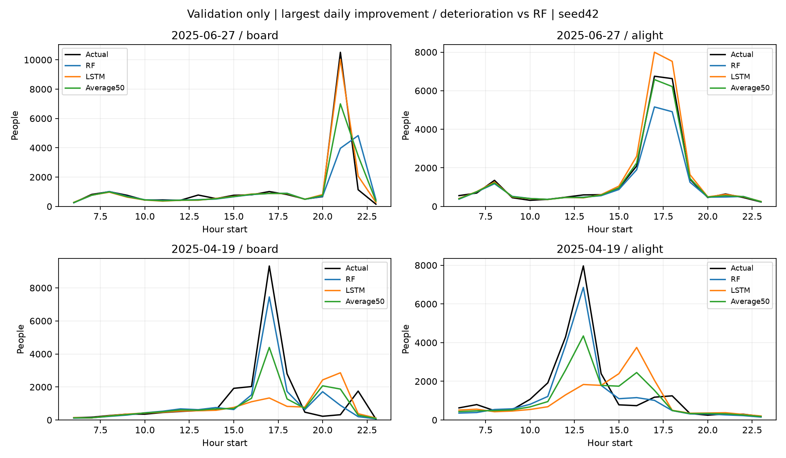

# ANALYSIS-006 상반기 오차유형·결합사례·예측비용

- 2026-11-11 사용자 요청. 시드42 RF3일·기존 LSTM14일배치8 및 고정50:50. 2025상반기181일만 사용. 하반기 예측/점수/최종평가 파일은 읽거나 갱신하지 않았다.
- 날짜별 총량오차, 시간별 절대오차 합, 피크 시각·최대크기·실제피크시점 오차를 계산. 합계절대오차≤시간별절대오차합을 검증. 그 차이는 하루 안에서 부호오차가 상쇄된 양이며 원인을 뜻하지 않는다.
- 총량·시각·규모 실패는 겹칠 수 있으므로 임의로 하나의 원인 분류에 배정하지 않는다. 하루 피크는 승하차별최대, 동률이면 가장 이른 시간.

| 모델 | 방향 | 피크시각 ±1시간 초과 일수 | 실제피크 과소예측 일수 | 일총량절대오차 합/시간절대오차 합 |
|---|---|---:|---:|---:|
| RF | board | 43/181 | 139/181 | 39.5% |
| RF | alight | 39/181 | 122/181 | 67.3% |
| LSTM | board | 50/181 | 126/181 | 60.5% |
| LSTM | alight | 44/181 | 133/181 | 69.9% |
| Average50 | board | 43/181 | 134/181 | 49.2% |
| Average50 | alight | 34/181 | 131/181 | 68.9% |

| 모델 | 방향 | 일총량 MAE | 피크크기 MAE | 피크시각 평균절대차(시간) |
|---|---|---:|---:|---:|
| RF | board | 2202.01 | 1673.75 | 1.73 |
| RF | alight | 2450.91 | 978.07 | 1.50 |
| LSTM | board | 3257.93 | 2254.33 | 1.79 |
| LSTM | alight | 3012.61 | 1461.61 | 1.42 |
| Average50 | board | 2590.80 | 1949.83 | 1.68 |
| Average50 | alight | 2587.62 | 1193.34 | 1.20 |

- 총량만으로 평가하면 하루 안에서 상쇄된 시간대 오차를 놓친다. 특히 RF승차의 총량절대오차합은 시간별절대오차합의39.5%에 불과하다. 그렇다고 나머지60.5%를 모두 피크 시각 문제로 단정하지는 않는다.
- 결합은 하차피크 시각 ±1시간초과 일수를39→34일로 줄였지만 실제피크 과소예측 일수는122→131일로 늘렸다. 시각과 규모를 함께 봐야 하는 사례다.

- 일별MAE 개선 125일, 악화 56일, 동률 0일. 횟수는 개선 크기를 대신하지 않는다.

## 성공·실패 사례

일별36개 평균MAE의 RF대비 감소량 상위/하위5일. 극단 사례이며 무작위 대표 표본이 아니다.

| 구분 | 날짜 | RF MAE | 결합 MAE | 감소량 |
|---|---|---:|---:|---:|
| 개선 | 2025-06-27 | 450.85 | 242.83 | +208.02 |
| 개선 | 2025-05-10 | 1095.76 | 930.74 | +165.02 |
| 개선 | 2025-04-04 | 499.98 | 339.29 | +160.69 |
| 개선 | 2025-04-05 | 799.24 | 657.91 | +141.33 |
| 개선 | 2025-05-30 | 339.39 | 203.99 | +135.40 |
| 악화 | 2025-04-19 | 415.99 | 713.57 | -297.58 |
| 악화 | 2025-03-22 | 229.55 | 441.09 | -211.54 |
| 악화 | 2025-04-20 | 566.29 | 754.26 | -187.97 |
| 악화 | 2025-04-26 | 368.35 | 551.64 | -183.30 |
| 악화 | 2025-06-29 | 286.12 | 429.98 | -143.86 |

위 각1위 날짜에서 개선/악화에 가장 크게 기여한 단일 관측값:

- 2025-06-27 21시 board: 실제10512, RF3965.18, LSTM10029.41, 결합6997.30; 절대오차 감소+3032.11명.
- 2025-04-19 17시 board: 실제9325, RF7454.61, LSTM1333.66, 결합4394.14; 절대오차 감소-3060.48명.

- 개선사례6/27에서는 RF가 크게 놓친21시승차피크를 LSTM이 더 가깝게 예측해 평균이 RF를 보완했다. 악화사례4/19에서는 RF가 상대적으로 잘 맞힌17시승차피크를 LSTM이 낮게 예측해 평균이 RF의 예측을 끌어내렸다. 구체 행사 원인을 확인한 분석은 아니다.

## 예측 비용

- 같은 WSL세션, RF CPU(n_jobs1)·LSTM GPU. 입력은 메모리에 준비한 한 날짜, 출력36개. 모델마다5회워밍업 후30회 측정, 순서 회전. GPU는 .numpy()로 완료 동기화. 입력준비/디스크로딩/초기 GPU기동은 제외하므로 서비스 전체지연이 아니다. 다른프로세스 부하를 통제한 벤치마크도 아니다.

| 구성 | 중앙값 ms | p95 ms | 저장파일 MiB |
|---|---:|---:|---:|
| RF | 6.59 | 12.75 | 6.273 |
| LSTM | 13.38 | 20.81 | 0.130 |
| Average50 | 19.82 | 28.87 | 6.404 |

- 파일 크기는 저장형식이 달라 직접 파라미터 효율로 해석하지 않는다. 신경망파일의 옵티마이저 상태 등도 포함될 수 있으며 RAM/VRAM실사용량과 다르다.
- [오차상세 JSON](../metrics/error_case_audit.json), [비용/환경 JSON](../metrics/prediction_cost.json). 날짜별 진단은 오차상세daily에 보존. 기존 학습시간은 각 실험 기록을 참조하며 이번 비용은 추론비용이다.
