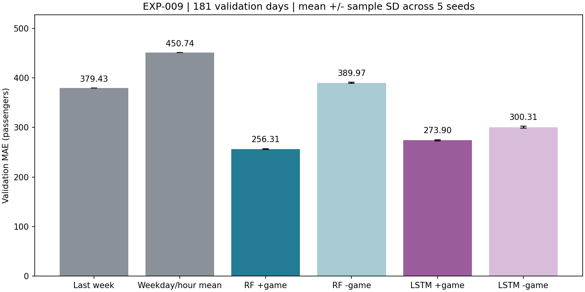

# EXP-009 단순 기준과 경기 정보 유무 비교

- 승인: [DEC-031](../decisions/training.md#dec-031), 명세 configs/ablation_2026-11-09.json.
- 학습 2024-01-15~12-31의 352일, 검증 2025-01-01~06-30의 181일. 기존 원본만 사용, 보충 행사/시범경기 자료 미사용. 하반기 최종 평가 미실행.
- 지난주 기준은 목표일 7일 전의 같은 시간 실제 인원이다. 검증 기간의 이전 관측도 사용한다. 요일·시간대 평균은 학습 352일에서만 계산하고 검증 중 갱신하지 않는다.
- RF 3일 나무200·깊이10·최소잎3, LSTM 14일 32유닛 한 층·Dense32·학습률0.003·batch16·최대2000·patience50·Dropout0. 모델별 다른 조건은 EXP-008 그대로다.
- 경기 포함은 EXP-008 저장 모델 복원 검증 후 재사용. 제외는 동일 5시드로 처음부터 학습. 과거 수요와 달력20개만 유지하며 경기 유무·건수·시각·존재표시·팀 입력을 모두 제거했다.
- 시드: 42·907394·892611·659988·622763. 평균은 각 시드 MAE의 평균이며 예측 앙상블의 성능이 아니다.

| 조건 | 검증 MAE | 시드 표준편차 | 승차 MAE | 하차 MAE |
|---|---:|---:|---:|---:|
| 지난주 같은 시간 | 379.43 | 해당 없음 | 420.20 | 338.66 |
| 학습 요일·시간대 평균 | 450.74 | 해당 없음 | 455.04 | 446.44 |
| RF 경기 포함 | 256.31 | 1.01 | 310.44 | 202.17 |
| RF 경기 제외 | 389.97 | 0.99 | 405.15 | 374.78 |
| LSTM 경기 포함 | 273.90 | 1.28 | 300.03 | 247.76 |
| LSTM 경기 제외 | 300.31 | 1.93 | 316.25 | 284.38 |

## 같은 시드에서 경기 정보의 추가 가치

차이 = 경기 제외 MAE − 경기 포함 MAE. 양수이면 경기 포함이 좋다. 표준편차는 시드 간 표본 표준편차다.

| 모델 | 시드 | 포함 MAE | 제외 MAE | 제외−포함 | 제외 최선/종료 에포크 | 종료 사유 | 신규 학습·검증 분 |
|---|---:|---:|---:|---:|---|---|---:|
| RF | 42 | 255.87 | 389.30 | +133.44 | 해당 없음 | 나무 학습 완료 | 0.09 |
| RF | 907394 | 256.55 | 391.31 | +134.76 | 해당 없음 | 나무 학습 완료 | 0.08 |
| RF | 892611 | 254.78 | 389.06 | +134.29 | 해당 없음 | 나무 학습 완료 | 0.09 |
| RF | 659988 | 257.11 | 389.43 | +132.32 | 해당 없음 | 나무 학습 완료 | 0.09 |
| RF | 622763 | 257.23 | 390.74 | +133.51 | 해당 없음 | 나무 학습 완료 | 0.09 |
| LSTM | 42 | 275.65 | 298.81 | +23.16 | 1087/1137 | 조기 종료 | 13.68 |
| LSTM | 907394 | 272.14 | 303.14 | +31.00 | 1999/2000 | 상한 도달 | 22.68 |
| LSTM | 892611 | 273.76 | 298.39 | +24.63 | 1334/1384 | 조기 종료 | 16.44 |
| LSTM | 659988 | 273.55 | 301.21 | +27.67 | 1194/1244 | 조기 종료 | 15.13 |
| LSTM | 622763 | 274.38 | 300.00 | +25.61 | 707/757 | 조기 종료 | 9.11 |

- RF: 제외−포함 평균 +133.66명, 차이의 표본 표준편차 0.93명. 경기 포함이 낮은 시드 5/5.
- RF 시드42 제외한 네 시드 평균: 포함 256.42, 제외 390.13명.

- LSTM: 제외−포함 평균 +26.42명, 차이의 표본 표준편차 3.04명. 경기 포함이 낮은 시드 5/5.
- LSTM 시드42 제외한 네 시드 평균: 포함 273.46, 제외 300.69명.

## 월별 확인

| 월 | 지난주 | 평균표 | RF 포함 | RF 제외 | LSTM 포함 | LSTM 제외 |
|---|---:|---:|---:|---:|---:|---:|
| 2025-01 | 147.14 | 393.49 | 111.98 | 200.44 | 81.81 | 87.60 |
| 2025-02 | 134.18 | 345.95 | 105.39 | 142.96 | 73.41 | 77.67 |
| 2025-03 | 423.20 | 466.89 | 263.72 | 384.81 | 286.85 | 330.01 |
| 2025-04 | 431.37 | 500.75 | 356.65 | 513.57 | 387.82 | 432.25 |
| 2025-05 | 649.12 | 538.00 | 379.80 | 562.07 | 427.92 | 477.63 |
| 2025-06 | 472.50 | 450.85 | 310.68 | 520.24 | 373.04 | 382.06 |

## 관찰과 다음 단계

- RF 경기 포함은 지난주 기준보다 MAE 32.45% 감소. 경기 제외 대비 감소율 34.28%. 신규 학습·검증 합계 0.43분(복원 검사·준비 시간 제외).
- LSTM 경기 포함은 지난주 기준보다 MAE 27.81% 감소. 경기 제외 대비 감소율 8.80%. 신규 학습·검증 합계 77.05분(복원 검사·준비 시간 제외).

| 사후 note 그룹 (날짜 수) | RF 포함 | RF 제외 | LSTM 포함 | LSTM 제외 |
|---|---:|---:|---:|---:|
| explicit_cancellation (6) | 571.15 | 538.77 | 479.61 | 439.29 |
| explicit_cancellation + no_special_note (1) | 1100.93 | 776.66 | 666.74 | 619.74 |
| no_record_unknown (95) | 123.12 | 209.02 | 97.52 | 108.43 |
| no_special_note (78) | 380.42 | 593.16 | 467.80 | 518.98 |
| other_note_unknown (1) | 494.52 | 451.03 | 277.78 | 319.11 |

- 다음으로 검증 구간에서 오차가 큰 날짜·시간대를 확인하고 별도 수집한 행사 기록과 대조하는 것을 권장한다. 전체 평균 개선을 개별 경기/행사의 인과효과로 해석하지 않는다.
- 이번에는 기존 하이퍼파라미터를 고정했다. 경기 제외 조건을 따로 최적화한 최선 모델과의 비교는 아니며, 추가 튜닝이나 신규 자료 결합은 실행하지 않았다.

[LSTM 5시드 학습·검증 곡선](../figures/EXP-009_lstm_curves.png)

학습 곡선은 배치 학습 중 손실이며 검증 MAE와 계산 시점/음수 보정 여부가 다르다. 작은 취소 그룹에서는 전체 평균과 다른 경향이 나올 수 있으므로 날짜 수와 함께 해석한다.

## 해석 범위와 검증

- 원본/KBO/공휴일 해시, 학습·검증·보류 날짜, 정답 배열, 모델별 패키지 버전의 일치를 확인했다. 포함·제외 모델 모두 복원 예측 확인(rtol=1e-5, atol=1e-4). LSTM GPU 가중치 배치를 확인했다.
- 입력 제거로 LSTM Dense 파라미터 수와 초기화 대응도 달라진다. 동일한 파라미터 수의 비교나 야구 개최의 인과효과가 아니다. 기존 최선 설정을 고정한 추가 예측 가치 비교다.
- 과거 승하차에는 이미 야구/행사의 영향이 포함될 수 있다. 경기 입력을 빼는 것이 야구 영향 자체를 제거한다는 뜻은 아니다.
- 모델별 과거 창 길이와 학습 조건이 다르다. 단순 기준보다 개선됐다는 사실만으로 경기 정보의 효과를 입증하지 않으며 포함/제외의 짝 비교를 별도로 본다.
- 기존 검증을 반복 사용했으므로 최종 일반화 성능이나 통계적 유의성의 증명이 아니다. 시드42는 과거 선택에 사용돼 다른 네 시드 평균도 함께 보고했다.
- 에포크 상한에서 종료한 조건은 수렴을 보장하지 않는다. 추가 학습으로 더 개선될 가능성과 현재 정해진 학습 예산에서의 비교를 구분한다.
- 예측 전날 실제 수요 확보 및 사후 일정의 당시 가용성 미검증, 기록 없음은 미확인이라는 한계는 유지된다. note는 사후 그룹 평가용이며 입력이 아니다.
- 전체/월별/note별 상세 지표는 공유 JSON, 모델·검증 예측·학습곡선·복원 로그는 outputs/ablation-2026-11-09/에 보관한다.
- [요약 JSON](../metrics/ablation_summary_2026-11-09.json), [기준](../metrics/ablation_baselines_2026-11-09.json), [RF](../metrics/ablation_rf_2026-11-09.json), [LSTM](../metrics/ablation_lstm_2026-11-09.json).
