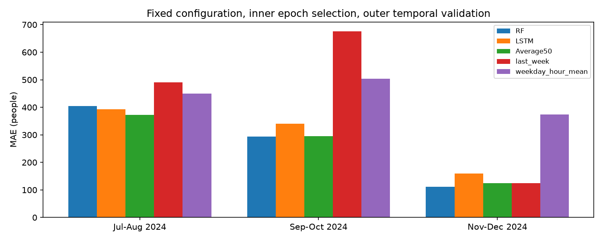
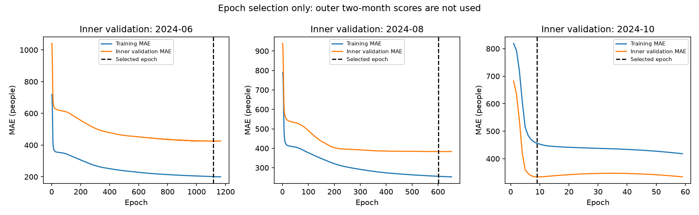

# EXP-016 2024년 시간순 후속 검증

2026-11-11 · DEC-039 · 하반기 최종 결과 보존 · 시드 42 고정.

## 절차

- RF 3일: 200나무·깊이10·최소잎3. LSTM 14일: 32유닛1층→달력/경기정보 결합→Dense32→36출력, Dropout0, MAE, Adam0.003, 배치8. 두 모델 각각 음수 보정 후 50:50.
- 학습 기간 마지막 한 달을 내부 검증으로 사용하여 최대2000·patience50으로 최선 횟수를 선택한다. 내부 학습만으로 전처리 적합. 이후 전체 학습 기간으로 전처리를 다시 맞추고 초기화부터 선택 횟수만큼 재학습. 외부 두 달은 학습·조기 종료에 사용하지 않음.
- 모든 목표는 2024-01-15부터 공통. 과거 실제 수요를 매일 갱신하는 하루 앞 예측. 기준 모델: 7일 전 동일 시간, 해당 학습 목표 날짜의 요일·시간 평균.
- 구간별 전처리·설정·곡선·모델·예측을 새 outputs 폴더에 저장. RF와 LSTM 각각 저장·복원 예측 일치 확인.
- 기존 설정은 전체2024 및 2025상반기를 사용해 개발한 설정이다. 외부 구간을 조기 종료에서 분리했어도, 이 분석을 완전히 새로운 독립 평가로 부르지 않는다. 짧은 학습 기간과 계절 변화가 동시에 달라져 원인을 하나로 단정하지 않는다.
- 각 외부 구간의 월은 학습에서 아직 경험하지 못한 달이다. 월 원핫 칸은 고정되어 있어도 해당 월의 효과를 학습한 것은 아니다. 내부 검증의 마지막 한 달 역시 앞선 내부 학습에 없는 달이다. 이는 실제 시간순 초기 운영의 제약이며, 1년 전체를 학습한 기존2025예측과 같은 조건이 아니다.

| 학습 종료 | 외부 검증 | 학습/검증 일수 | 내부 최선/종료 에포크 | 종료 사유 | 총 소요(초) |
|---|---|---:|---:|---|---:|
| 2024-06-30 | 2024-07-01~2024-08-31 | 168/62 | 1116/1166 | early_stopping | 1149.1 |
| 2024-08-31 | 2024-09-01~2024-10-31 | 230/61 | 602/652 | early_stopping | 866.1 |
| 2024-10-31 | 2024-11-01~2024-12-31 | 291/61 | 9/59 | early_stopping | 62.4 |

| 검증 기간 | 모델 | 전체 MAE | 승차 MAE | 하차 MAE | 승차 RMSE | 하차 RMSE |
|---|---|---:|---:|---:|---:|---:|
| 2024-07-01~2024-08-31 | RF | 404.31 | 439.02 | 369.59 | 1174.05 | 875.93 |
| 2024-07-01~2024-08-31 | LSTM | 392.48 | 437.04 | 347.92 | 1441.52 | 979.06 |
| 2024-07-01~2024-08-31 | Average50 | 372.07 | 412.12 | 332.03 | 1236.09 | 812.33 |
| 2024-07-01~2024-08-31 | last_week | 489.89 | 568.29 | 411.49 | 1773.36 | 1118.39 |
| 2024-07-01~2024-08-31 | weekday_hour_mean | 450.10 | 459.76 | 440.45 | 1353.09 | 1089.72 |
| 2024-09-01~2024-10-31 | RF | 293.48 | 326.27 | 260.69 | 1035.08 | 652.16 |
| 2024-09-01~2024-10-31 | LSTM | 339.73 | 331.23 | 348.23 | 1243.51 | 1014.37 |
| 2024-09-01~2024-10-31 | Average50 | 295.45 | 307.87 | 283.04 | 1072.19 | 770.12 |
| 2024-09-01~2024-10-31 | last_week | 676.28 | 644.70 | 707.86 | 1995.63 | 1708.17 |
| 2024-09-01~2024-10-31 | weekday_hour_mean | 503.42 | 486.56 | 520.28 | 1349.26 | 1137.62 |
| 2024-11-01~2024-12-31 | RF | 112.09 | 113.47 | 110.72 | 338.72 | 280.07 |
| 2024-11-01~2024-12-31 | LSTM | 159.25 | 162.44 | 156.06 | 370.91 | 328.87 |
| 2024-11-01~2024-12-31 | Average50 | 124.96 | 131.84 | 118.08 | 346.52 | 290.90 |
| 2024-11-01~2024-12-31 | last_week | 123.92 | 123.44 | 124.40 | 466.59 | 373.09 |
| 2024-11-01~2024-12-31 | weekday_hour_mean | 374.15 | 361.97 | 386.33 | 828.25 | 787.84 |

184일 공통 외부 예측을 이어 붙여 계산한 MAE(구간 단순평균 아님):

- RF: 270.69명
- LSTM: 297.67명
- Average50: 264.75명
- last_week: 430.36명
- weekday_hour_mean: 442.60명

## 해석

- 2024-07-01~2024-08-31: RF 대비 결합 MAE 감소 +32.23명. 이 구간 최저 MAE는 Average50.
- 2024-09-01~2024-10-31: RF 대비 결합 MAE 감소 -1.97명. 이 구간 최저 MAE는 RF.
- 2024-11-01~2024-12-31: RF 대비 결합 MAE 감소 -12.87명. 이 구간 최저 MAE는 RF.

- 184일 합계에서는 결합이 RF보다 약2.20% 개선했지만 3구간 중 2구간은 RF가 더 좋았다. 전체 개선은 7~8월 개선의 영향이 크다. 모든 기간의 안정적 우위라고 주장하지 않는다.
- 마지막 구간은 내부 검증(10월) MAE가 9회333.99명에서 최선, 59회334.39명으로 patience50 종료. 그동안 학습 손실은 456.33→418.25로 감소했다. 종료 규칙의 오류가 아니라 내부 기간에 민감한 에포크 선택이며, 충분히 학습된 모든 LSTM이 비시즌에 불리하다는 결론으로 확장하지 않는다. 외부 결과를 보고 추가 횟수로 재실행하지 않았다.
- 마지막 구간의 결합124.96명은 전주 기준123.92명보다도 약간 높았다. 단순 기준과 비교하는 이유를 보여주는 사례다.
- 각 구간의 학습/평가까지 총 소요 합계는 약34분38초이며, 앞선 감사·보고서 작성 시간은 제외한다.
- 이번 결과는 안정성 진단이며 최종 구성/하반기 결과를 바꾸지 않는다. 경기 일정의 사전 가용성·실제 자료 공개 지연 한계는 유지된다.
- [환경·설정·구간별 지표·보존 해시](../metrics/robustness_backtests.json)

- 실행: `./tools/run_wsl_python.ps1 tools/verify_robustness.py`, 보고서: `.venv/Scripts/python.exe tools/report_robustness.py`.
