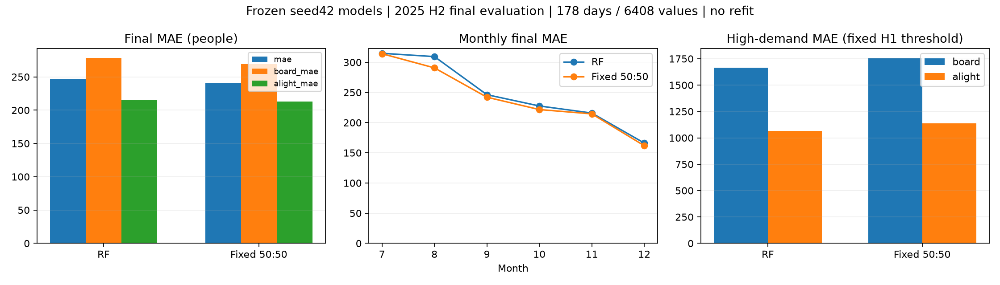

# FINAL-001 고정 RF·LSTM50:50와 RF 단독 최종 평가

- 2026-11-11 사용자 승인 및 DEC-037. 최종 평가 전 configs/final_evaluation.json에 모델·전처리·설정SHA256과 결합비율을 고정했다. 시드42 RF3일·잎3 및 LSTM14일·1층32·배치8·MAE·Dropout0. 재학습 없음.
- 학습2024년352일, 선택/조기종료2025상반기181일, 최종평가2025-07-01~12-31 중178일(6408개 인원값). 과거 탐색6일: 2025-09-25, 2025-09-26, 2025-09-27, 2025-09-28, 2025-09-30, 2025-10-01 제외. 제외일 점수는 계산하지 않았다.
- 매일 전날까지의 실제 수요를 입력하는 하루앞 예측이다. 하반기 전체를6개월 전에 예측한 것이 아니다. 전날23~24시 자료까지 확보 가정이며 실제 공개 지연·야구일정의 당시 가용성은 미검증.
- 각 모델 음수예측을0으로 보정 후50:50 평균, 반올림 없음. 최종 결과에 따라 가중치·모델·날짜·입력을 조정하지 않았다. 학습 전처리와 최선가중치를 그대로 재사용.

| 구성 | 상반기 검증 MAE | 하반기 최종 MAE | 승차 MAE | 하차 MAE | 승차 RMSE | 하차 RMSE |
|---|---:|---:|---:|---:|---:|---:|
| RF | 255.87 | 246.98 | 278.41 | 215.54 | 857.46 | 526.40 |
| RF_LSTM_50 | 250.55 | 241.04 | 269.00 | 213.07 | 880.37 | 548.92 |

- 고정50:50의 RF 대비 MAE 감소 +5.94명(+2.41%). 양수 개선·음수 악화.

## 월별 최종 MAE

| 월 | 평가 일수 | RF | 고정50:50 |
|---|---:|---:|---:|
| 2025-07 | 31 | 314.84 | 314.19 |
| 2025-08 | 31 | 309.39 | 290.70 |
| 2025-09 | 25 | 246.29 | 242.12 |
| 2025-10 | 30 | 227.58 | 221.62 |
| 2025-11 | 30 | 215.84 | 214.52 |
| 2025-12 | 31 | 166.15 | 161.78 |

## 고수요·피크

상반기에서 정한 고수요 임계값을 평가 전 고정: 승차1049.3명 이상, 하차1425.6명 이상. 하반기 상위10%를 다시 선택한 것이 아니므로 표본 비율은10%와 다를 수 있다. 실제 혼잡/안전 기준은 아니다. 피크는 일별 최대, 동률이면 가장 이른 시간.

| 구성 | 방향 | 고수요 표본수 | 고수요 MAE | 일반 MAE | 고수요 부족 인원 | 피크 MAE |
|---|---|---:|---:|---:|---:|---:|
| RF | board | 314 | 1663.42 | 127.93 | 1471.35 | 1984.09 |
| RF | alight | 328 | 1063.64 | 118.82 | 972.72 | 1076.86 |
| RF_LSTM_50 | board | 314 | 1757.37 | 107.28 | 1616.90 | 2160.90 |
| RF_LSTM_50 | alight | 328 | 1136.88 | 107.72 | 1100.17 | 1262.68 |

## 해석

- 평가 전에 확정한 시드42 고정50:50이 전체MAE에서 RF보다5.94명(2.41%) 낮았다. 승차·하차MAE 및7~12월 각 월의 전체MAE도 개선했다. 상반기에서 확인한 전체MAE 개선 방향이 이번 하반기에서도 유지됐다.
- 반면 승차/하차RMSE, 고수요MAE·부족인원 및 실제 피크시점MAE는 RF보다 악화했다. 평균적인 시간대 정확도 개선과 큰 급증 대응 한계를 함께 보고한다. RMSE는 큰 오차에 더 민감하므로 MAE 개선과 모순이 아니다.
- 최종모델을 사후에 변경하지 않고 고정50:50 결과를 보고한다. 고수요 특화 대응은 향후 개선 과제이다. '모든 상황에서 RF보다 우수' 또는 '과적합이 없다'고 주장하지 않는다.
- 발표용 문장: “상반기 검증으로 선택한 RF·LSTM 고정50:50 조합은 별도 하반기178일 평가에서 MAE241.04명으로 RF단독 대비2.41% 개선됐다. 다만 고수요·피크 오차와 RMSE는 RF보다 높아 급증 대응의 한계가 남았다.”

## 재현·한계

- 두 모델의 저장된 검증예측 재현, 전체 대상 날짜·정답 완전일치, 원본/모델/전처리/설정SHA256 확인. 유한예측·평균범위 검사 통과. note상태별 점수는 JSON에 보존하며 기록없음을 비경기일로 확정하지 않음.
- 저장 예측파일을 별도 스크립트 tools/plot_final_evaluation.py로 재계산하여 전체MAE·50:50 산술·월별 일수 가중합178일 일치를 확인하고 그래프를 렌더 검토했다.
- 상반기와 하반기는 수요 분포·계절·경기 구성이 달라 점수 차이를 모델 개선/악화의 단일 원인으로 설명할 수 없다. 단일시드·한 평가기간이므로 통계적 유의성이나 모든 기간 우위를 주장하지 않는다.
- 하반기는 이제 공개된 평가 결과이므로 향후 이를 보고 수정한 모델에는 독립 최종평가로 다시 주장하지 않는다. 추가 실험은 후속 탐색으로 구분해야 한다.
- 재현 명령: tools/evaluate_final.py --source <기존CSV> --kbo-source <기존KBO>. 기존출력 덮어쓰기 금지. 환경·원본·구성은 [전체JSON](../metrics/final_evaluation.json)에 기록. 출력예측은 outputs/final-evaluation-2026-11-11/test_predictions.npz에 보존.
